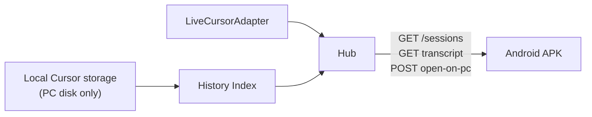
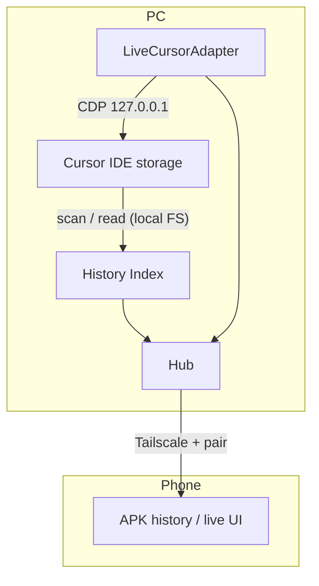
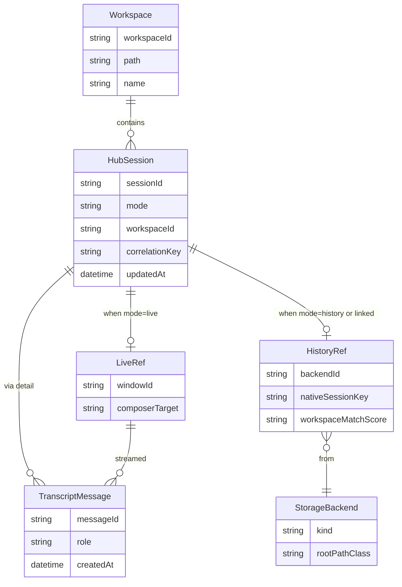
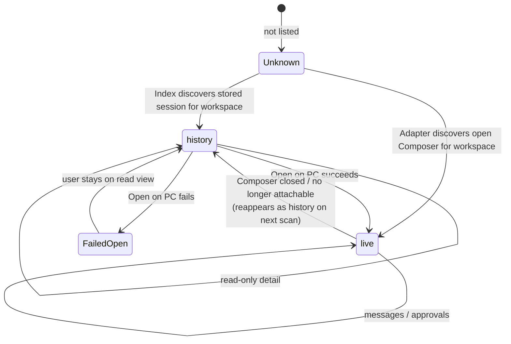
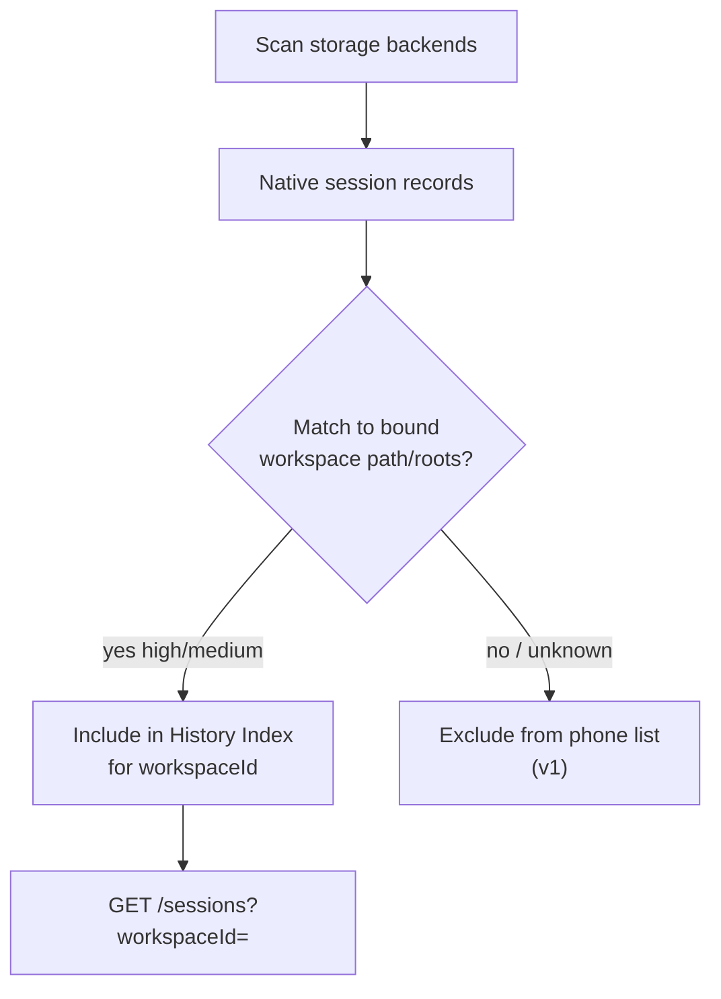
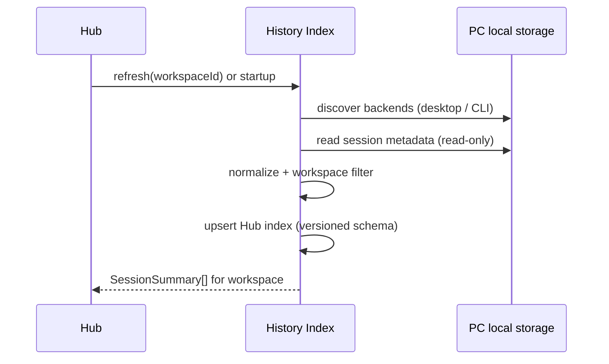
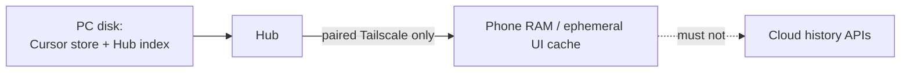
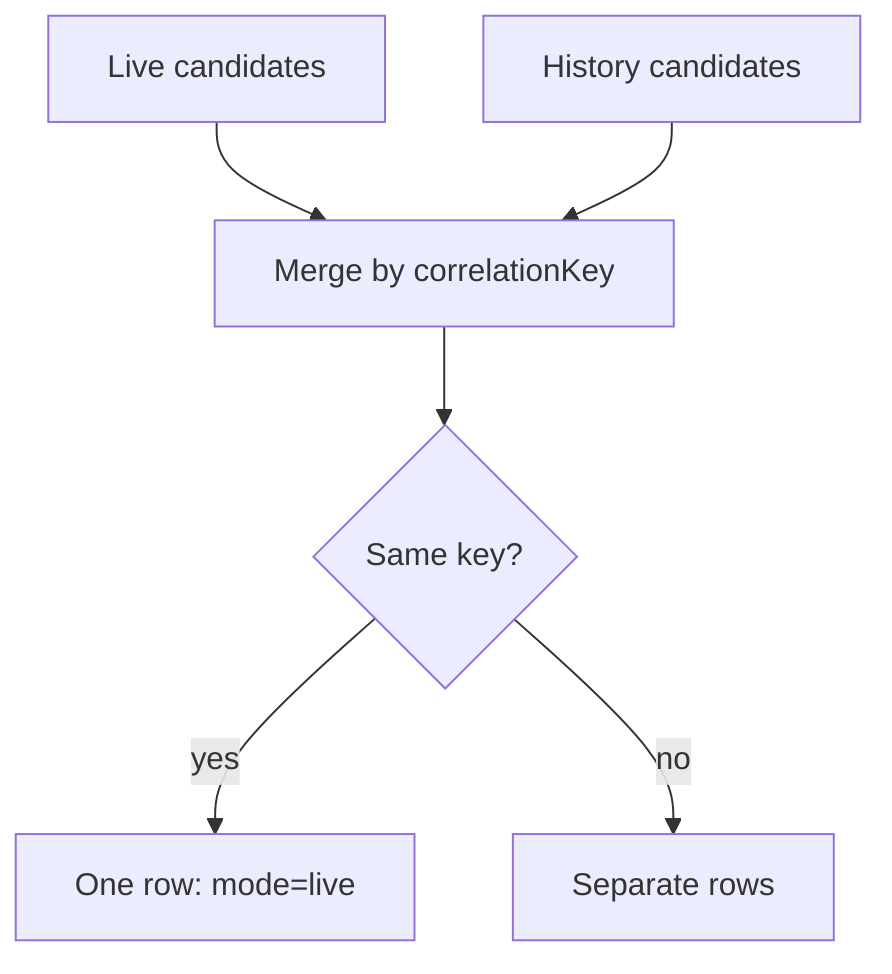
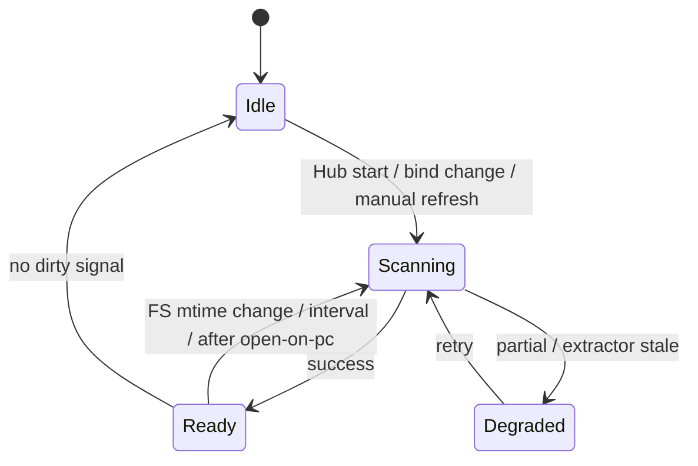
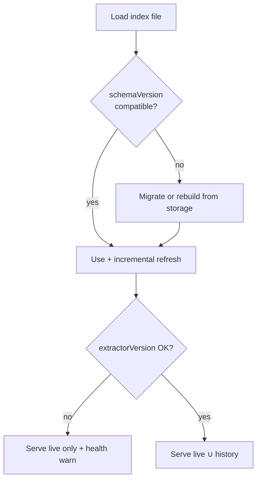

<!-- generated-by: gsd-doc-writer -->
# TOR-07 — History Index & Session Data

**Status:** Phase 2 **partially implemented** — local scan + Hub list/messages/open-on-pc (A→B→C path wired; strategy B fail-closed while `composer_history_open` is CANDIDATE)  
**Volume:** 07 of 00–08  
**Phase affinity:** Phase **2** (full local history + Open on PC); Phase 1 may stub empty history  
**Canonical feature UX:** [`docs/features/remote-sessions.md`](../../features/remote-sessions.md)  
**FR anchors:** FR-020–023, FR-040–041  
**Reference class:** [cursor-session](https://github.com/iksnae/cursor-session) (local extract/export patterns — not a live control surface)
**Implementation:** `packages/adapters/history` · Hub `GET /sessions?mode=history` · `GET /sessions/:id/messages` · `POST /sessions/:id/open-on-pc` · Live `reopenComposerContext` · see [`handoff-phase2-history.md`](../handoff-phase2-history.md)

---

## 1. Purpose and scope

This Terms of Reference defines the **History Index** (`adapters/history`) and the Hub’s session-data contracts so the phone can:

1. List **all** past local Composer/chat sessions that belong to the **PC-open project**.
2. Read a history session as a **read-only transcript** on the phone.
3. Invoke **Open on PC** so that session becomes `live` inside the same workspace.



### In scope

| Area | Designed outcome |
|------|------------------|
| Session identity | Stable Hub `sessionId` with clear live vs history provenance |
| Workspace filtering | History rows only for bound `workspaceId` |
| Local storage scan | Adapter discovers classes of Cursor desktop / agent-CLI storage |
| Transcript schema | Normalized message model for phone read views |
| Open on PC | Resolve → focus workspace → reopen Composer → mode=`live` |
| Privacy / retention | Transcripts and index stay on the PC; phone caches minimally |
| Index performance | Incremental scan, cache, bounded latency for list/detail |
| Refresh | When and how the index updates vs live CDP |
| Live ↔ history conflict | Dedup and preference rules when both sources know a session |
| Index versioning | Schema migrations without cloud sync |

### Out of scope

| Banned | Why |
|--------|-----|
| Cloud Agents / Remote Control / cloud session catalogs | Product lock: PC-local only |
| Phone dialing CDP or reading Cursor storage directly | Phone never reaches PC disk or CDP |
| Re-implementing tools/MCP on the phone | Tools run on PC; history is read + open-on-PC |
| Guaranteeing proprietary Cursor internal key layouts | Adapter owns discovery; TOR describes **classes**, not secret schemas |
| Writing history back into Cursor’s private DB as a supported API | Open-on-PC uses Live adapter UI/CDP paths; storage write-back is best-effort / UI-driven |

---

## 2. Product locks (non-negotiable)

| Lock | Meaning for History Index |
|------|---------------------------|
| **PC-local only** | No cloud history APIs; no sync of transcripts off-machine |
| **Open-project remote** | Index queries always filtered to Hub-bound workspace (v1) |
| **Continue or create** | History supports continue via Open on PC; create stays Live adapter |
| **Tailscale + pairing** | Phone receives history **only** through authenticated Hub |
| **CDP localhost** | History Index does **not** use CDP to scrape chat text as primary source |
| **Docs ≠ code** | Routes and schemas below are **designed** until `adapters/history` exists |

---

## 3. Component responsibilities

| Component | Responsibility |
|-----------|----------------|
| **History Index** (`adapters/history`) | Discover local session stores; map to workspace; build/maintain index; load transcripts; resolve identity for Open on PC |
| **Hub** (`packages/hub`) | Merge live ∪ history for `GET /sessions`; authorize; expose detail + `POST .../open-on-pc`; never ship raw DB files to phone |
| **LiveCursorAdapter** (`adapters/live`) | After Open on PC: focus Composer, stream live transcript, messages, approvals |
| **APK** | Read-only history UI; Open on PC button; switch to live chat on success |
| **Cursor IDE (on PC)** | System of record for live state; owner of on-disk chat storage |



---

## 4. Session identity model

### 4.1 Dual-source identity

Sessions presented to the phone are **Hub session records**. Each record has:

| Field (designed) | Description |
|------------------|-------------|
| `sessionId` | Opaque Hub id used in all APIs (`/sessions/:id/...`) |
| `mode` | `live` \| `history` \| (`editor` optional later) |
| `workspaceId` | Must match Hub-bound PC-open project |
| `liveRef` | Optional handle into LiveCursorAdapter (window / composer target) |
| `historyRef` | Optional handle into History Index (storage backend id + native key) |
| `title` / `preview` | Display strings |
| `updatedAt` | Last activity (live stream or stored last message) |
| `model` | Last known model label if discoverable |
| `correlationKey` | Stable cross-source key for dedup (see §11) |

**Rule:** Phone and Hub clients must treat `sessionId` as opaque. Native Cursor storage keys never leave the Hub as a public contract.

### 4.2 Live vs history ids



| Source | Id nature | Created by | Lifetime |
|--------|-----------|------------|----------|
| **Live** | Ephemeral adapter attachment to open Composer/agent UI | LiveCursorAdapter when CDP sees an active session | Until window closes / detach / Hub restart (may re-bind via `correlationKey`) |
| **History** | Durable index row keyed by `historyRef` | History Index scan | Until storage entry gone or purged from index |
| **Hub `sessionId`** | Stable for Hub API duration of the logical conversation | Hub when first listing or opening | Survives mode flip history→live when `correlationKey` matches |

### 4.3 Mode transitions



---

## 5. Workspace filtering

### 5.1 Bind gate

1. Hub holds a single active **bound workspace** (or user-selected window when multi-window — FR-014).
2. Every history list/detail/open-on-pc call requires `workspaceId` matching that bind (explicit query param or implied from auth context).
3. Mismatch → reject (same rule as create — FR-013).

### 5.2 Matching stored sessions to a workspace

History Index must associate each native session with zero or more workspace paths using **adapter matching**, not phone-side guessing.

Designed match signals (priority order):

| Priority | Signal | Notes |
|----------|--------|-------|
| 1 | Explicit workspace path / folder URI stored with the chat | Best |
| 2 | Workspace hash / id used by desktop storage for that folder | Adapter maps hash → path via known VS Code/Cursor workspace mapping classes |
| 3 | Heuristic: majority of file refs under bound roots | Lower confidence; mark `matchConfidence` |
| 4 | Unmatched | **Omit from phone list** for this bind (do not dump global PC history) |



**v1 policy:** Only sessions confidently tied to the bound project appear. Prefer false negatives over leaking other projects’ chats.

### 5.3 Multi-root / renamed folders

| Case | Designed behavior |
|------|-------------------|
| Multi-root workspace | Match if any root equals or contains stored path association |
| Folder renamed/moved | May drop from history until rematch; Open on PC only if bind path still valid |
| Same repo path, different window | Dedup by `correlationKey`; prefer live row if open |

---

## 6. Local Cursor storage scan (adapter responsibilities)

> **Important:** Cursor’s on-disk formats are **third-party / evolving**. This TOR specifies **storage classes and adapter duties**, not proprietary row keys, encryption secrets, or undocumented schema internals. Implementation may follow public patterns from cursor-session-class tools and must degrade gracefully when layouts change.

### 6.1 Storage classes (designed)

| Class | Typical location class (OS) | Role | Priority |
|-------|----------------------------|------|----------|
| **Desktop app globalStorage DB** | Linux: `~/.config/Cursor/User/globalStorage/` (e.g. `state.vscdb`-class SQLite); macOS: `~/Library/Application Support/Cursor/User/globalStorage/` | Primary IDE Composer/chat history for desktop Cursor | **Primary** |
| **Workspace storage** | `.../Cursor/User/workspaceStorage/<hash>/` class | Workspace metadata linking folder → storage id | Supporting match |
| **Agent CLI chat stores** | Linux: `~/.config/cursor/chats/` or `~/.cursor/chats/` class | cursor-agent CLI sessions if present | Secondary |
| **Export / cache (Hub-owned)** | Hub data dir under PC user profile (designed path TBD at scaffold) | Normalized index + optional transcript cache | Hub-controlled |

Public reference for desktop + CLI backends: [cursor-session storage backends](https://github.com/iksnae/cursor-session) (desktop `state.vscdb`-class; agent CLI chats dirs). Desktop app storage takes priority when both exist.

### 6.2 Adapter responsibilities (not phone / not Hub HTTP)

| Duty | Description |
|------|-------------|
| **Discover** | Detect which storage classes exist on this OS/user |
| **Open read-only** | Open DBs/files with shared/read locks; never corrupt Cursor’s store |
| **Extract** | Pull session list metadata + message payloads into **normalized** models |
| **Map workspace** | Resolve native workspace associations → absolute paths → `workspaceId` |
| **Cache** | Maintain Hub-side index snapshot for fast list |
| **Version-gate** | Detect unsupported layout → health flag `history_extractor_stale` (designed) |
| **Abstain** | If extraction fails, Hub still serves **live** sessions; history empty + clear error |

### 6.3 What the adapter must not do

- Upload transcripts to any remote service.
- Require Cursor API keys in the APK.
- Depend on public CDP for history enumeration.
- Invent fake sessions when storage is empty or unreadable.
- Expose raw SQLite dumps or absolute home-directory paths beyond workspace banner needs (paths in metadata may include project path already known via `/workspace`).

### 6.4 Scan pipeline (designed)



---

## 7. Transcript schema (normalized)

Phone and Hub APIs use a **normalized transcript**, independent of Cursor’s internal encoding.

### 7.1 Session detail (designed)

```json
{
  "sessionId": "hub_...",
  "mode": "history",
  "workspaceId": "...",
  "title": "Fix Hub pairing",
  "model": "composer-...",
  "createdAt": "2026-09-20T12:00:00Z",
  "updatedAt": "2026-09-20T13:40:00Z",
  "messageCount": 42,
  "source": {
    "backend": "desktop_globalStorage",
    "nativeKeyFingerprint": "sha256:..."
  },
  "messages": [ "see Message" ],
  "capabilities": {
    "canOpenOnPc": true,
    "readOnly": true
  }
}
```

`nativeKeyFingerprint` is a **one-way** fingerprint for diagnostics — not the raw proprietary key.

### 7.2 Message entity

| Field | Type | Notes |
|-------|------|-------|
| `messageId` | string | Hub-stable within session |
| `role` | `user` \| `assistant` \| `system` \| `tool` | Normalized |
| `createdAt` | ISO-8601 | If unknown, omit or approximate from order |
| `parts` | Part[] | Ordered content |
| `toolCall` | optional | For tool rows: name, status, args summary (no secret env dumps) |

**Part types (designed):** `text` | `code` | `file_ref` | `tool_result` | `unknown`

```json
{
  "messageId": "m_...",
  "role": "assistant",
  "createdAt": "2026-09-20T12:05:00Z",
  "parts": [
    { "type": "text", "text": "I'll update the Hub health check." },
    { "type": "code", "language": "ts", "text": "..." }
  ]
}
```

### 7.3 Live vs history transcript

| Mode | Source of messages | Mutability |
|------|-------------------|------------|
| `history` | History Index extract / cache | Read-only on phone |
| `live` | LiveCursorAdapter stream (+ optional seed from history after Open on PC) | Append via messages/approvals |

After successful Open on PC, Hub may **seed** the live view with the last N history messages, then switch the feed to live events.

---

## 8. Hub API surface (history slice)

Designed endpoints (not implemented):

| Method | Path | Role |
|--------|------|------|
| `GET` | `/sessions?workspaceId=` | Unified live ∪ history summaries |
| `GET` | `/sessions/:id` | Detail + transcript (history or live snapshot) |
| `POST` | `/sessions/:id/open-on-pc` | History → live transition |
| `POST` | `/sessions/:id/messages` | **Live only** — reject if still `history` |
| `POST` | `/sessions/:id/approvals` | **Live only** |
| `GET` | `/health` | Include history indexer status |

### 8.1 List row (designed)

```json
{
  "sessionId": "hub_...",
  "mode": "history",
  "workspaceId": "...",
  "title": "...",
  "preview": "I'll update the Hub...",
  "updatedAt": "2026-09-20T13:40:00Z",
  "model": "composer-...",
  "correlationKey": "ck_..."
}
```

### 8.2 Open-on-PC response (designed)

```json
{
  "sessionId": "hub_...",
  "mode": "live",
  "workspaceId": "...",
  "liveRef": { "windowId": "...", "composerTarget": "..." },
  "historyRef": { "backendId": "desktop_globalStorage", "linked": true }
}
```

---

## 9. Open on PC — flow detail

Maps to FR-040–041 and [`remote-sessions.md`](../../features/remote-sessions.md).

### 9.1 Preconditions

| Check | Failure UX |
|-------|------------|
| Paired + Tailscale up | Connectivity error |
| Bound workspace present | “Open a project in Cursor on the PC” |
| Session `mode=history` and `canOpenOnPc` | Hide/disable button or clear error |
| `workspaceId` matches bind | Reject |
| History Index can resolve `historyRef` | “Cannot reopen this session” |
| LiveCursorAdapter / CDP healthy | Health: CDP down |

### 9.2 Sequence

```mermaid
sequenceDiagram
  participant User
  participant APK
  participant Hub
  participant Hist as History Index
  participant Live as LiveCursorAdapter
  participant Cursor as Cursor on PC

  User->>APK: Open history session
  APK->>Hub: GET /sessions/:id
  Hub->>Hist: loadTranscript(historyRef)
  Hub-->>APK: read-only messages

  User->>APK: Open on PC
  APK->>Hub: POST /sessions/:id/open-on-pc
  Hub->>Hist: resolve identity + workspace match
  Hub->>Hub: assert workspaceId == bind
  Hub->>Live: focusBoundWorkspace()
  Live->>Cursor: focus window / project
  Hub->>Live: reopenComposerContext(history hints)
  Live->>Cursor: open/select Composer as UI allows
  alt Success
    Hub->>Hub: mode = live; attach liveRef; keep historyRef link
    Hub-->>APK: mode=live + sessionId
    APK->>APK: Navigate to live chat + WS
  else Failure
    Hub-->>APK: error (unsupported shape / UI / window)
    Note over APK: Stay on history read; no cloud fallback
  end
```

### 9.3 Reopen strategies (designed, best-effort)

Cursor has **no supported two-way sync API** for all historical chats (research gap). Open on PC is therefore staged:

| Strategy | Description | Expected reliability |
|----------|-------------|----------------------|
| **A. Focus existing live** | If `correlationKey` already live, just attach | High |
| **B. UI reopen** | Live adapter navigates Composer history UI to the matching chat | Medium — selector churn |
| **C. New live + context paste** | Create new Composer in same project; inject summary/refs (last resort) | Lower fidelity — must label UX as “continued as new” if used |
| **D. Fail closed** | Clear error; remain `history` | Always available |

**Product rule:** Prefer A→B; use C only with explicit user-visible caveat; never invent a cloud resume path.

### 9.4 Post-transition guarantees

- Same `workspaceId` before and after.
- Phone switches to live chat + approval cards.
- Subsequent messages/approvals go through LiveCursorAdapter.
- History Index may later re-index the same conversation under the same `correlationKey`.

---

## 10. Retention and privacy

### 10.1 Data residency

| Data | Resides on | Leaves PC? |
|------|------------|------------|
| Cursor native chat storage | PC disk (user profile) | No (Hub reads locally) |
| History Index / cache | PC (Hub data dir) | No |
| Transcript over wire | PC Hub → phone over Tailscale | Only to **paired** device as API JSON |
| Cloud session catalogs | — | **Forbidden** |



### 10.2 Phone-side retention (designed)

| Store on phone | Allowed |
|----------------|---------|
| Device pair token | Yes (secure storage) |
| Hub URL / MagicDNS | Yes |
| Full transcript disk cache | **No** by default (optional short TTL memory/disk cache with clear-on-unpair) |
| Screenshots of chats | Out of Hub control — not a product feature |

### 10.3 Hub retention policy (designed)

| Knob | Designed default |
|------|------------------|
| Index retention | Mirror Cursor store lifetime; delete index rows when native gone |
| Transcript cache | Optional; invalidate on native mtime change |
| Logs | No full prompt bodies in info logs; debug opt-in on PC only |
| Unpair / revoke | Does not wipe PC Cursor history; only blocks phone access |

### 10.4 Sensitive content

Transcripts may contain secrets the user pasted into Composer. Treat as **sensitive local data**:

- Hub API requires pairing.
- Prefer Tailscale ACLs limiting Hub port to user devices.
- Do not include raw tool env dumps in normalized `toolCall` summaries.

---

## 11. Live vs history conflict rules

When Live adapter and History Index both surface the “same” conversation:

| Situation | Rule |
|-----------|------|
| Same `correlationKey`, one live + one history | **Emit single row**, `mode=live`; keep `historyRef` linked |
| Live open, history also lists older snapshot | Prefer live for list; detail uses live stream |
| Open on PC while already live | Idempotent: return existing live `sessionId` |
| History open-on-PC creates new Composer (strategy C) | New `sessionId` live; old history row remains; link via `continuedFromSessionId` |
| Conflicting titles/models | Prefer live metadata while `mode=live` |
| Workspace match disagrees | Trust Hub bind; drop history row if cannot confirm |



**`correlationKey` construction (designed):** fingerprint of (workspace path class + native session key fingerprint) or adapter-provided stable chat id when available. Never use random ids that break across Hub restarts without persistence.

---

## 12. Indexing performance

### 12.1 Targets (designed SLOs)

| Operation | Target (designed) |
|-----------|-------------------|
| Cold full scan (desktop backend) | Complete without blocking Hub HTTP event loop (async job) |
| Warm `GET /sessions` with history | Prefer &lt; 300 ms from cache for typical project |
| `GET /sessions/:id` transcript | Prefer &lt; 1 s for median session; stream/paginate if huge |
| Concurrent Hub APIs | History refresh must not stall live WS |

### 12.2 Techniques

| Technique | Purpose |
|-----------|---------|
| Incremental scan by file/DB mtime | Avoid full rewrite |
| Metadata-first index | List without loading all messages |
| Lazy transcript load | Detail endpoint pulls messages on demand |
| Pagination | `?cursor=` / `limit` on messages (designed) |
| Worker isolation | Scan in child process/worker to protect Hub |
| Backpressure | Coalesce refresh requests |

### 12.3 Scale assumptions (v1)

Personal single-user PC: hundreds to low thousands of sessions across projects; filter to one workspace → typically dozens–hundreds. Design for thousands of messages per session with pagination.

---

## 13. Refresh strategy



| Trigger | Behavior |
|---------|----------|
| Hub startup | Full discover + index build (async) |
| Workspace bind change | Re-filter index for new `workspaceId`; may rescan match maps |
| Interval poll | Light mtime check (designed; interval knob TBD — see CONFIGURATION) |
| After Open on PC / new session | Soft refresh so new live↔history links appear |
| APK pull-to-refresh | `GET /sessions` may force `refresh=1` (designed) |
| Live WS events | Do **not** rewrite entire history index per token |

**Consistency model:** List may be briefly stale vs disk; Open on PC always re-resolves `historyRef` at call time.

---

## 14. Migration and versioning of the index

### 14.1 Index schema version

Hub-owned index documents a `schemaVersion` integer.

```json
{
  "schemaVersion": 1,
  "builtAt": "2026-09-25T18:00:00Z",
  "backends": ["desktop_globalStorage"],
  "sessions": []
}
```

### 14.2 Migration rules

| Event | Action |
|-------|--------|
| Hub upgrade, `schemaVersion` bump | Run migrator; on failure rebuild from scratch from Cursor storage |
| Cursor storage layout change | Bump `extractorVersion`; if incompatible → `history_extractor_stale`, empty history, live still works |
| Corrupt index file | Delete Hub cache; rebuild |
| Downgrade Hub | Rebuild if schema newer than binary supports |



### 14.3 Compatibility with reference tools

cursor-session-class export formats (JSONL / Markdown / YAML / JSON) may be used as **offline debug aids**. They are not the phone wire format. Wire format = normalized Hub JSON in §7.

---

## 15. Health and observability (history)

Designed `/health` additions:

| Field | Meaning |
|-------|---------|
| `history.ok` | Indexer process responsive |
| `history.backends[]` | Detected storage classes |
| `history.lastScanAt` | Timestamp |
| `history.sessionCountForBind` | Count for current workspace |
| `history.extractorVersion` | Adapter build id |
| `history.extractorStale` | Layout mismatch / parse failures |

---

## 16. Error catalog (designed)

| Code / condition | User-facing meaning |
|------------------|---------------------|
| `WORKSPACE_MISMATCH` | Session not for open project |
| `HISTORY_UNAVAILABLE` | Storage not readable / extractor stale |
| `SESSION_NOT_FOUND` | Unknown `sessionId` |
| `OPEN_ON_PC_UNSUPPORTED` | Cannot reopen this history shape |
| `OPEN_ON_PC_CDP_DOWN` | Live adapter cannot focus Cursor |
| `NOT_LIVE` | Messages/approvals called while still history |

---

## 17. Testing requirements (designed)

| Layer | Cases |
|-------|-------|
| Unit | Workspace match scoring; correlationKey merge; schema migration |
| Integration | Fake storage fixtures → list filter; transcript normalize |
| Manual UAT | Real PC: list history for open project; read; Open on PC → live chat |
| Negative | Wrong workspace rejected; CDP down during open-on-pc; empty storage |

Do **not** commit real user transcript fixtures containing secrets.

---

## 18. Implementation map (future code)

```
adapters/history/
  discover.ts          # storage class detection
  extractors/          # per-backend read-only extractors
  matchWorkspace.ts    # path / hash matching
  indexStore.ts        # versioned Hub cache
  normalize.ts         # → transcript schema
  openOnPc.ts          # resolve + handoff hints to Live adapter
packages/hub/
  routes/sessions.ts   # merge live ∪ history; open-on-pc
```

Until these exist, all contracts remain **DESIGNED**.

---

## 19. Acceptance criteria (Phase 2)

- [ ] `GET /sessions?workspaceId=` returns history rows only for the bound project (FR-022, FR-023).
- [ ] History detail is read-only transcript on phone (FR-040).
- [ ] `POST /sessions/:id/open-on-pc` yields `mode=live` in the same workspace or a clear error (FR-041).
- [ ] No cloud history endpoints or credentials in the path.
- [ ] Live and history for the same conversation collapse to one preferred row (§11).
- [ ] Index rebuild/migration works after Hub upgrades (§14).
- [ ] Phone never reads PC disk or CDP for history.

---

## 20. Entity list (summary)

| Entity | Description |
|--------|-------------|
| **Workspace** | PC-open project bind (`workspaceId`, path, roots) |
| **HubSession** | Phone-facing session (`sessionId`, mode, correlationKey) |
| **LiveRef** | CDP/UI attachment handle |
| **HistoryRef** | Storage backend + native key fingerprint |
| **StorageBackend** | desktop_globalStorage / agent_cli_chats / hub_cache |
| **SessionSummary** | List row DTO |
| **SessionDetail** | Detail DTO + capabilities |
| **TranscriptMessage** | Normalized message |
| **MessagePart** | text / code / file_ref / tool_result / unknown |
| **ToolCallSummary** | Safe tool metadata for history read |
| **HistoryIndexDocument** | Versioned on-disk Hub index |
| **HealthHistory** | Indexer status block |
| **OpenOnPcResult** | Post-transition live session payload |
| **CorrelationKey** | Cross-source dedup identity |

---

## 21. Related documents

| Doc | Why |
|-----|-----|
| [`docs/features/remote-sessions.md`](../../features/remote-sessions.md) | Continue live + history UX |
| [`docs/architecture/functional-requirements.md`](../../architecture/functional-requirements.md) | FR-020–023, FR-040–041 |
| [`docs/architecture/mobile-cursor-companion.md`](../../architecture/mobile-cursor-companion.md) | History Index component |
| [`docs/architecture/AGENT-CONTEXT.md`](../../architecture/AGENT-CONTEXT.md) | Briefing pack |
| [`docs/reports/gap-closure-hybrid-system-2026-09-24.md`](../gap-closure-hybrid-system-2026-09-24.md) | Gap: all project history |
| [`research/cursor-mobile-remote-ide-oss.md`](../../../research/cursor-mobile-remote-ide-oss.md) | cursor-session landscape notes |
| TOR-06 LiveCursorAdapter | Open-on-PC handoff target |
| TOR-03 Hub/API | Full HTTP contracts (when present) |

---

## 22. Open gaps (for implementers)

1. Exact Hub data-dir path and config knobs for scan interval (scaffold-time).
2. Which Open-on-PC strategy (A/B/C) works on current Cursor UI — validate in Spike before Phase 2 lock.
3. Multi-window bind (FR-014) interaction with history filter.
4. Pagination defaults for very long transcripts.
5. Whether agent-CLI chat class is in Phase 2 MVP or Phase 2.1 (desktop primary).
