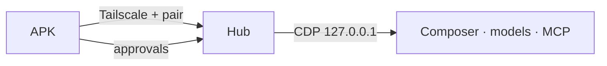
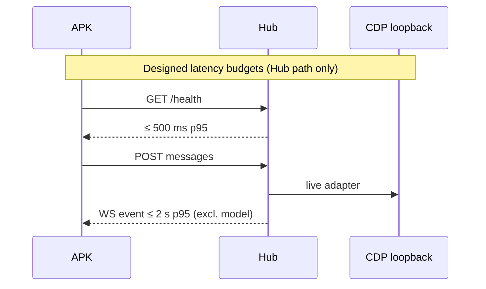
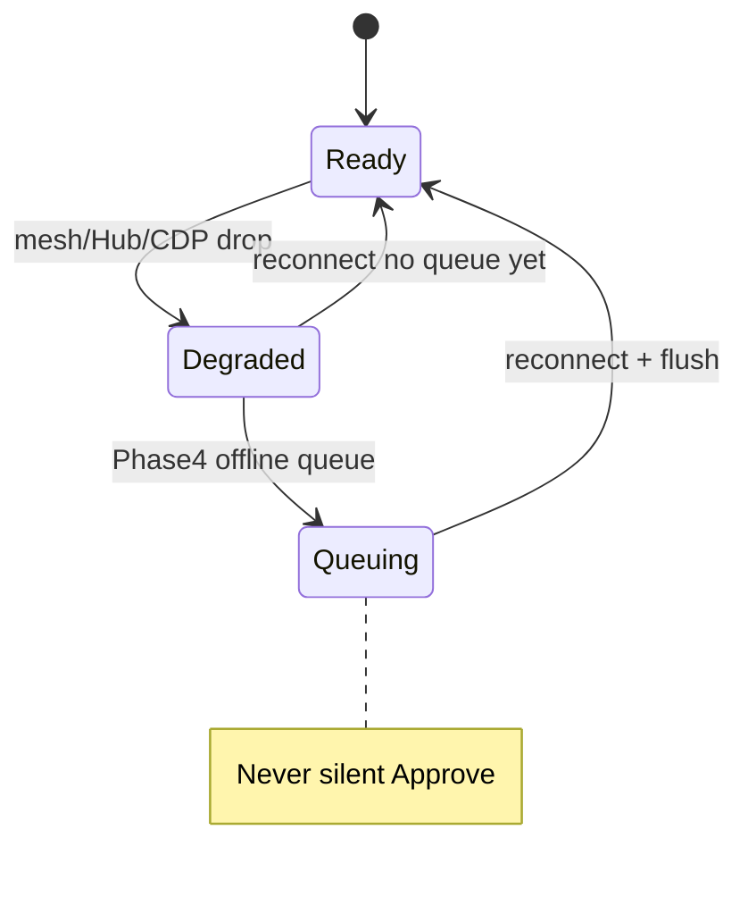
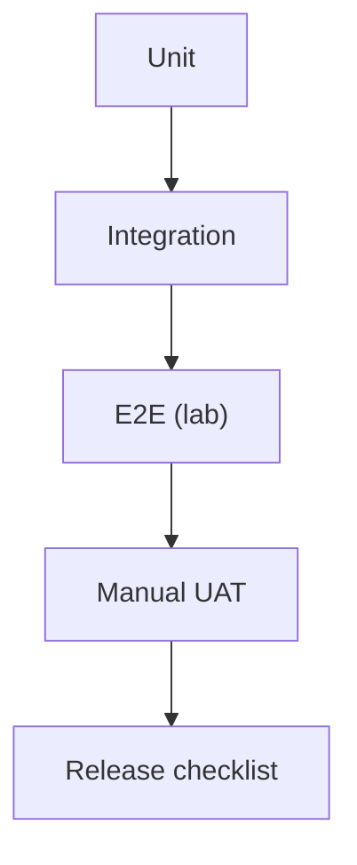
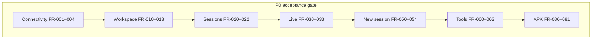
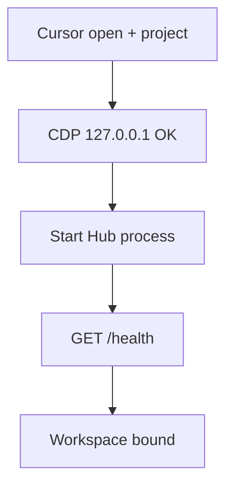
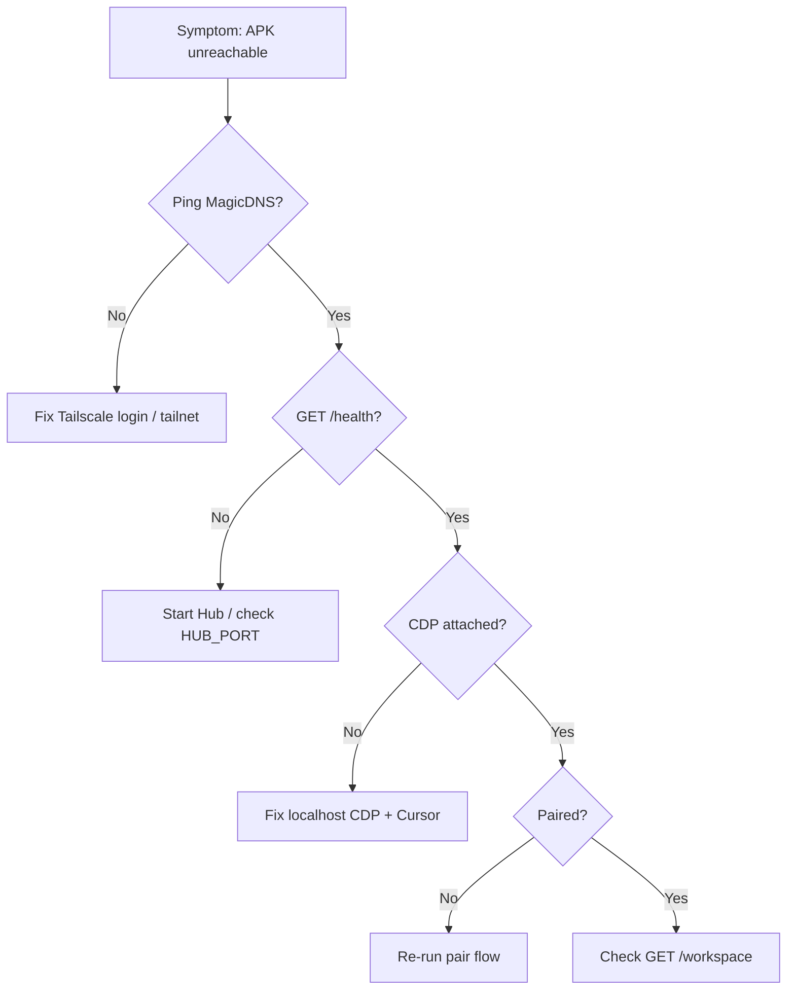
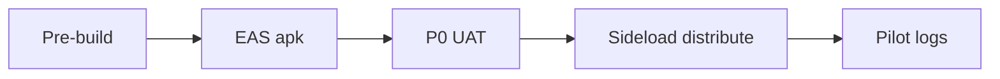
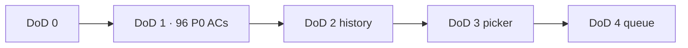
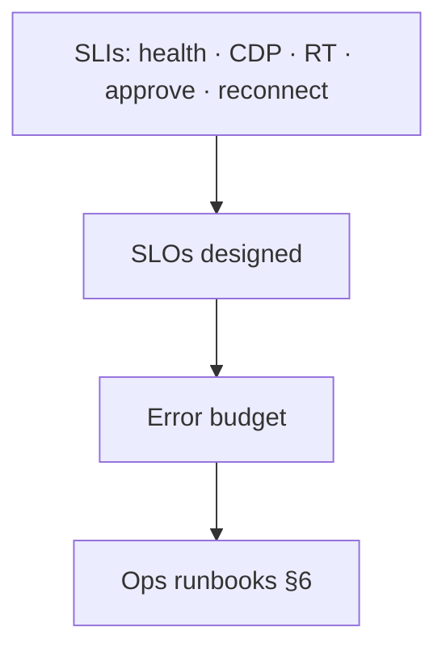

<!-- generated-by: gsd-doc-writer -->
# TOR-08 — NFR, Testing, Ops & Acceptance

**Status:** DESIGNED — **not implemented**  
**Date:** 2026-09-25  
**Product:** PC-local Cursor companion Android APK  
**Audience:** Implementers, QA, operators, release owners  
**Canonical FRs:** [`../../architecture/functional-requirements.md`](../../architecture/functional-requirements.md)  
**Operator path:** [`../../GETTING-STARTED.md`](../../GETTING-STARTED.md) · [`../../CONFIGURATION.md`](../../CONFIGURATION.md)  
**Phases:** 0–4 in [`../../architecture/AGENT-CONTEXT.md`](../../architecture/AGENT-CONTEXT.md)

---

## Product locks (non-negotiable)

| Lock | Meaning for this TOR |
|------|----------------------|
| **PC-local only** | No Cloud Agents / Remote Control / cloud workers in tests, SLOs, or runbooks |
| **Open-project remote** | Acceptance assumes a folder already open in Cursor on the PC |
| **Continue or create** | Live continue + new session (model + attach + PC tools / phone approvals) |
| **Tailscale + pairing** | Mesh + device token required before session APIs |
| **CDP localhost** | CDP on `127.0.0.1` only; phone never dials CDP |
| **Expo sideload APK** | Release artifact is EAS `android.buildType: apk` |
| **Docs ≠ code** | All knobs, SLOs, runbooks, and cases below are **designed** until Hub/APK exist |



---

## 1. Purpose and scope

### 1.1 Purpose

Define the **non-functional requirements**, **test strategy**, **P0 acceptance catalog**, **ops runbooks**, **APK release checklist**, **Definition of Done per phase 0–4**, and **designed metrics/SLOs** so implementation and QA share one contract.

### 1.2 In scope

- Performance, reliability, offline/reconnect, battery, observability (designed targets)
- Unit / integration / e2e / manual UAT strategy
- Acceptance cases mapped to P0 FRs (FR-001–004, 010–013, 020–022 live, 030–033, 050–054, 060–062, 080–081)
- Ops: start Hub, CDP, Tailscale troubleshoot
- Release checklist for sideload APK
- Phase DoD 0–4 and designed SLOs

### 1.3 Out of scope

- Scaffolding Hub/APK code (this doc does not claim packages exist)
- Cloud session catalogs, public CDP, ngrok-as-default, phone-side MCP
- Production SaaS monitoring dashboards (product is PC-local)

---

## 2. Non-functional requirements (designed)

All IDs are **NFR-xxx**. Targets are design goals for when code lands; none are measured in-repo today.

### 2.1 Performance

| ID | Requirement | Designed target | Notes |
|----|-------------|-----------------|-------|
| NFR-PERF-01 | Hub `GET /health` p95 latency over Tailscale (same region/tailnet) | ≤ 500 ms | Excludes Tailscale cold start |
| NFR-PERF-02 | `GET /workspace` p95 after Hub warm | ≤ 1 s | CDP attach already established |
| NFR-PERF-03 | Live message round-trip (phone → Hub → CDP → WS event) p95 | ≤ 2 s under light load | Composer UI / model latency excluded from Hub SLA |
| NFR-PERF-04 | Approval apply (Approve/Deny → PC effect) p95 | ≤ 1.5 s | Deny must be observable on PC |
| NFR-PERF-05 | File search `GET /workspace/files?q=` p95 for typical monorepo | ≤ 2 s | Indexing strategy TBD at scaffold |
| NFR-PERF-06 | New session create `POST /sessions` to live chat ready | ≤ 5 s Hub+adapter path | Model first-token not in Hub budget |
| NFR-PERF-07 | APK cold start to Health screen | ≤ 3 s on mid-range Android | Expo baseline |



### 2.2 Reliability / availability

| ID | Requirement | Designed target |
|----|-------------|-----------------|
| NFR-REL-01 | Hub process stays up while Cursor + CDP healthy | Operator-restart model; no HA cluster in v1 |
| NFR-REL-02 | Transient Tailscale blip ≤ 30 s | Auto-reconnect WS without re-pair (aligns FR-090 P1) |
| NFR-REL-03 | No silent tool approval on reconnect | Block approvals until `Ready` (security doc states) |
| NFR-REL-04 | Health distinguishes Hub up vs CDP attached | FR-004 |
| NFR-REL-05 | Pairing token revocation takes effect | Immediate reject of revoked device token |
| NFR-REL-06 | Crash recovery | Hub restart re-binds workspace; APK reuses stored device token |

### 2.3 Offline / reconnect / queue

| ID | Requirement | Phase | Designed behavior |
|----|-------------|-------|-------------------|
| NFR-OFF-01 | Clear offline / degraded UI states | 0+ | TailscaleDown, HubDown, CursorDown, CDPOff, Unpaired, Revoked |
| NFR-OFF-02 | Reconnect without re-pair | 1–2 (FR-090 P1) | Token retained unless revoked |
| NFR-OFF-03 | Offline message/approval **queue** | 4 (FR-091) | Queue outbound; flush on `Ready`; never auto-approve |
| NFR-OFF-04 | Queue durability | 4 | Survive APK process kill for queued items (designed) |
| NFR-OFF-05 | Stale CDP selectors | 4 | Adapter self-check + operator-visible CDPOff |



### 2.4 Battery / mobile resource use

| ID | Requirement | Designed target |
|----|-------------|-----------------|
| NFR-BAT-01 | WS idle keepalive | Sparse ping; backoff when backgrounded |
| NFR-BAT-02 | Polling | Prefer WS events over aggressive HTTP poll; `WORKSPACE_POLL_MS` Hub-side only |
| NFR-BAT-03 | Background behavior | Pause live stream rendering when app backgrounded; retain connection policy TBD |
| NFR-BAT-04 | Screen wake | Do not force wake lock except during active approval needing user response (optional Phase 1+) |
| NFR-BAT-05 | No CDP from phone | Phone never opens debug ports (battery + security) |

### 2.5 Observability

| ID | Requirement | Designed sink |
|----|-------------|---------------|
| NFR-OBS-01 | Structured Hub logs | Local file / stdout — levels info/warn/error |
| NFR-OBS-02 | Correlation IDs | `requestId` / `sessionId` on HTTP + WS |
| NFR-OBS-03 | Health payload fields | Hub up, CDP attach, workspace bound, paired-device count (no secrets) |
| NFR-OBS-04 | Metrics (local) | Counters/histograms for latency, WS reconnects, approval outcomes |
| NFR-OBS-05 | APK diagnostics | Health screen + last error code; no Cursor cloud keys in crash reports |
| NFR-OBS-06 | Redaction | Device tokens, pair codes never in logs |

Designed health shape (illustrative — **not shipped**):

```json
{
  "hub": "up",
  "cdp": "attached|detached",
  "workspaceBound": true,
  "workspaceId": "...",
  "pairedDevices": 1,
  "version": "designed"
}
```

---

## 3. Test strategy (designed)



### 3.1 Unit tests

| Area (planned packages) | Focus |
|-------------------------|--------|
| `packages/hub` | Pairing token TTL, workspaceId scope checks, health aggregation, request validation |
| `adapters/live` | DOM/CDP selector helpers (mocked CDP), approval mapping, message serialization |
| `adapters/history` | Workspace filter, session mode tagging |
| `apps/mobile` | Screen state machines (Pair → Health → Home), error copy mapping, offline queue reducer (Phase 4) |

**Rule:** No unit test may require real Cursor UI or live Tailscale.

### 3.2 Integration tests

| Suite | Boundary | Designed approach |
|-------|----------|-------------------|
| Hub ↔ mock CDP | Live adapter | Fake CDP server on `127.0.0.1` |
| Hub ↔ History Index | Local store | Temp directory fixtures |
| Hub auth | Pair middleware | Unpaired → 401; paired → 200 |
| Hub bind | Workspace | Empty vs bound workspace responses |

### 3.3 End-to-end (lab)

| Layer | Designed lab |
|-------|----------------|
| Network | Two devices or VM phone emulator + PC on same Tailscale (or documented lab substitute) |
| Cursor | Real Cursor with test project open + CDP `127.0.0.1:9222` |
| Hub | Local Hub process |
| APK | Debug or release APK sideloaded |

E2E covers happy paths: pair → banner → live chat → approve/deny → new session. Flaky CDP UI selectors are tracked as Phase 4 hardening debt.

### 3.4 Manual UAT

| Track | When | Owner |
|-------|------|-------|
| Phase gate UAT | End of each phase 0–4 | Operator + implementer |
| P0 FR catalog | Before claiming Phase 1 complete | QA / agent following §5 |
| Security smoke | Every release | Confirm CDP not on Tailscale; no secrets in APK |
| Regression | After Cursor IDE updates | Live adapter smoke (selectors) |

### 3.5 Test environments (designed)

| Env | Topology |
|-----|----------|
| Dev | Single PC: Hub + Cursor + emulator/phone on tailnet |
| Staging | Dedicated PC/VM on tailnet; separate pairing secrets ([CONFIGURATION.md](../../CONFIGURATION.md)) |
| Prod | Still PC-local — hardened ACLs + pairing TTL; **no cloud mode** |

---

## 4. Acceptance test catalog — P0 FRs

**Convention:** `AC-<FR>-<nn>` · Result: Pass / Fail / Blocked · Status of catalog: **DESIGNED**.

**Estimate:** ~**96** discrete P0 acceptance cases below (happy + negative / edge). Phase 1+ P1/P2 cases are listed separately in §4.10 (~24 more) for planning, not P0 gate.



### 4.1 Connectivity & pairing (FR-001–004) — 16 cases

| Case ID | FR | Type | Steps (summary) | Expected |
|---------|----|------|-----------------|----------|
| AC-001-01 | FR-001 | Happy | Hub bound to Tailscale/private path; phone reaches Hub | Hub API reachable over mesh |
| AC-001-02 | FR-001 | Negative | From another host, attempt CDP on PC Tailscale IP | CDP **not** reachable |
| AC-001-03 | FR-001 | Negative | Confirm CDP listen address | Only `127.0.0.1` (designed default `:9222`) |
| AC-001-04 | FR-001 | Negative | APK settings / network capture | No remote CDP URL stored |
| AC-002-01 | FR-002 | Happy | Complete `POST /pair/...` with valid code/QR | Device token issued; session APIs work |
| AC-002-02 | FR-002 | Negative | Call `GET /workspace` without pair | Rejected (401 / unpaired) |
| AC-002-03 | FR-002 | Negative | Expired pair code | Clear error; no token |
| AC-002-04 | FR-002 | Happy | Re-pair after revoke | New token; old rejected |
| AC-003-01 | FR-003 | Negative | Tailscale down | APK shows Tailscale/offline actionable error |
| AC-003-02 | FR-003 | Negative | Hub stopped, mesh up | “Hub not running” (or equivalent) |
| AC-003-03 | FR-003 | Negative | Invalid/missing pair | Pair prompt / unpaired state |
| AC-003-04 | FR-003 | Negative | Wrong hostname | Unreachable error, not silent hang |
| AC-004-01 | FR-004 | Happy | `GET /health` when Hub+CDP OK | Reports Hub up + CDP attached |
| AC-004-02 | FR-004 | Negative | CDP off, Hub up | Health shows Hub up, CDP detached |
| AC-004-03 | FR-004 | Happy | APK Health screen mirrors payload | Distinct Hub vs CDP indicators |
| AC-004-04 | FR-004 | Negative | Hub down | Health call fails; APK HubDown state |

### 4.2 Workspace binding (FR-010–013) — 14 cases

| Case ID | FR | Type | Steps (summary) | Expected |
|---------|----|------|-----------------|----------|
| AC-010-01 | FR-010 | Happy | Open project in Cursor; Hub detects | `GET /workspace` returns name/path/roots |
| AC-010-02 | FR-010 | Happy | Switch folder on PC; refresh | Workspace payload updates |
| AC-011-01 | FR-011 | Happy | Paired APK Home | Banner name+path match PC folder |
| AC-011-02 | FR-011 | Happy | Pull-to-refresh | Banner refreshes from Hub |
| AC-012-01 | FR-012 | Negative | Close all folders in Cursor | Hub empty/unavailable; APK empty state copy |
| AC-012-02 | FR-012 | Negative | Empty state UI | **No** fake project / cloud picker |
| AC-012-03 | FR-012 | Happy | Re-open project | Banner returns; empty state cleared |
| AC-013-01 | FR-013 | Happy | Create session with bound `workspaceId` | Succeeds |
| AC-013-02 | FR-013 | Negative | `POST /sessions` with foreign `workspaceId` | Rejected |
| AC-013-03 | FR-013 | Happy | Session list scoped to bound id | No other projects’ sessions |
| AC-013-04 | FR-013 | Negative | Tamper workspaceId in client | Hub rejects |
| AC-010-03 | FR-010 | Edge | Hub before Cursor open | Empty/unavailable, not crash |
| AC-011-03 | FR-011 | Edge | Long path | Truncate/wrap; full path available |
| AC-012-04 | FR-012 | Edge | Cursor quit entirely | CursorDown / open Cursor messaging |

### 4.3 Session listing & modes — live P0 (FR-020–022) — 10 cases

| Case ID | FR | Type | Steps (summary) | Expected |
|---------|----|------|-----------------|----------|
| AC-020-01 | FR-020 | Happy | Open live Composer on PC | Appears in `GET /sessions?workspaceId=` |
| AC-020-02 | FR-020 | Happy | Phase 1 list | Live sessions present (full history not required) |
| AC-021-01 | FR-021 | Happy | Inspect list rows | Mode badge `live` (and `history` when present) |
| AC-021-02 | FR-021 | Edge | Unknown mode from Hub | Safe fallback; no crash |
| AC-022-01 | FR-022 | Happy | Only bound project sessions shown | No unrelated PC projects |
| AC-022-02 | FR-022 | Negative | UI audit | No cloud session catalog entry points |
| AC-020-03 | FR-020 | Negative | Wrong workspace query | Empty or error; no cross-leak |
| AC-022-03 | FR-022 | Happy | Two projects historically on PC | Phone still only shows bound one |
| AC-021-03 | FR-021 | Happy | Open live row | Navigates to Live chat |
| AC-020-04 | FR-020 | Edge | No sessions | Empty list + New session CTA |

### 4.4 Continue live (FR-030–033) — 16 cases

| Case ID | FR | Type | Steps (summary) | Expected |
|---------|----|------|-----------------|----------|
| AC-030-01 | FR-030 | Happy | Send message from phone | Appears in PC Composer; reply streams to phone |
| AC-030-02 | FR-030 | Happy | WS reconnect mid-chat | Messages resume (token kept) |
| AC-030-03 | FR-030 | Negative | Send while HubDown | Error / queue (Phase 4) — no silent success |
| AC-031-01 | FR-031 | Happy | Tool call appears as card | Approve succeeds on PC path |
| AC-031-02 | FR-031 | Happy | Deny tool call | PC does not continue that approval path |
| AC-031-03 | FR-031 | Negative | Drop mesh during pending approval | State visible; no silent approve |
| AC-031-04 | FR-031 | Happy | MCP/plugin-shaped call | Card + Approve/Deny still work |
| AC-032-01 | FR-032 | Happy | Attach file from workspace root | Ref appears in PC Composer context |
| AC-032-02 | FR-032 | Negative | Path outside roots | Rejected by Hub |
| AC-032-03 | FR-032 | Happy | Multiple attachments | All applied |
| AC-033-01 | FR-033 | Negative | No “always allow” silent path on phone | User must act per call (v1) |
| AC-033-02 | FR-033 | Negative | Automations / macros | Must not auto-approve via phone API |
| AC-030-04 | FR-030 | Edge | Large message | Handled or clear limit error |
| AC-031-05 | FR-031 | Edge | Rapid Approve then Deny race | Deterministic last-ack / server order |
| AC-032-04 | FR-032 | Edge | Binary / large file | Policy: reject or warn (designed) |
| AC-030-05 | FR-030 | Happy | Concurrent PC typing | Phone still receives stream (best-effort) |

### 4.5 New session (FR-050–054) — 18 cases

| Case ID | FR | Type | Steps (summary) | Expected |
|---------|----|------|-----------------|----------|
| AC-050-01 | FR-050 | Happy | Open create sheet; load models | Models from `GET /workspace/models` only |
| AC-050-02 | FR-050 | Negative | Submit without model | Blocked in UI / API validation |
| AC-050-03 | FR-050 | Negative | Empty model list | Clear “no models” state |
| AC-051-01 | FR-051 | Happy | Search/list files under roots | Paths returned; attach works |
| AC-051-02 | FR-051 | Happy | Zero attachments | Create still allowed |
| AC-051-03 | FR-051 | Negative | Attach outside roots | Rejected |
| AC-052-01 | FR-052 | Happy | Optional prompt provided | Included in `POST /sessions` body |
| AC-052-02 | FR-052 | Happy | No prompt | Session created; live chat opens |
| AC-052-03 | FR-052 | Happy | Body includes workspaceId, model, attachments | Matches designed contract |
| AC-053-01 | FR-053 | Happy | After create | PC Composer focused in **open** project |
| AC-053-02 | FR-053 | Happy | Model + file refs applied | Visible in Cursor session |
| AC-053-03 | FR-053 | Happy | Optional first prompt sent | Appears as first user message |
| AC-053-04 | FR-053 | Negative | No project open | Create fails; empty-state guidance |
| AC-054-01 | FR-054 | Happy | Tools summary shown | Informational only |
| AC-054-02 | FR-054 | Negative | User cannot “start MCP on phone” | No phone tool runtime |
| AC-050-04 | FR-050 | Edge | Model disappears mid-flow | Refresh / clear error |
| AC-051-04 | FR-051 | Edge | Multi-root project | Files only under declared roots |
| AC-052-04 | FR-052 | Edge | agentMode set | Passed through if Hub supports |

### 4.6 Tools / MCP (FR-060–062) — 8 cases

| Case ID | FR | Type | Steps (summary) | Expected |
|---------|----|------|-----------------|----------|
| AC-060-01 | FR-060 | Happy | Trigger tool from live session | Executes inside Cursor on PC |
| AC-060-02 | FR-060 | Happy | Observe side effects on PC | Files/shell/MCP on PC only |
| AC-061-01 | FR-061 | Negative | APK package audit | No MCP server host / tool runtime |
| AC-061-02 | FR-061 | Negative | Network from APK | Only Hub over Tailscale (designed) |
| AC-062-01 | FR-062 | Happy | Approval UI for observed calls | Covers tool/plugin/MCP cards |
| AC-062-02 | FR-062 | Edge | Unknown tool shape | Still shows denyable card or safe fallback |
| AC-060-03 | FR-060 | Negative | Kill Cursor mid-tool | CDPOff / error; no phone-side retry execution |
| AC-062-03 | FR-062 | Happy | Deny path verified on PC | Aligns AC-031-02 |

### 4.7 APK delivery (FR-080–081) — 10 cases

| Case ID | FR | Type | Steps (summary) | Expected |
|---------|----|------|-----------------|----------|
| AC-080-01 | FR-080 | Happy | EAS profile `android.buildType: apk` | Produces `.apk` artifact |
| AC-080-02 | FR-080 | Negative | AAB-only profile | **Not** the release path for this product |
| AC-080-03 | FR-080 | Happy | Sideload install on Android | App launches |
| AC-081-01 | FR-081 | Happy | Screens present | Pair, banner, session list, live chat, approvals, new-session |
| AC-081-02 | FR-081 | Happy | P0 flows complete on device | Maps to §§4.1–4.6 happy paths |
| AC-081-03 | FR-081 | Negative | No cloud login required for P0 | Works with Hub pair only |
| AC-080-04 | FR-080 | Edge | Unknown sources / install permission | Documented in release notes |
| AC-081-04 | FR-081 | Happy | Health screen reachable | From Pair / Home |
| AC-081-05 | FR-081 | Negative | Secrets scan of APK | No Cursor/cloud API keys; no remote CDP |
| AC-080-05 | FR-080 | Happy | Version label visible | Build number for support |

### 4.8 Cross-cutting P0 smoke (4 cases)

| Case ID | Covers | Expected |
|---------|--------|----------|
| AC-X-01 | Full path | Tailscale → Hub → pair → banner → live deny → new session. **Note:** Composer/CDP apply when `liveAdapter=cdp_ok` (CDP remains `127.0.0.1`-only on the PC; never public). When `cursor_down`, Hub create-queue **HTTP 202** is the accepted fail-closed path (PC-local queue; no invented Composer DOM). CDP is **not** required for AC-X-01 Pass when Hub queues. |
| AC-X-02 | Security | CDP not on Tailscale; Hub only phone API |
| AC-X-03 | Empty workspace | Blocking empty state; no invent project |
| AC-X-04 | Locks | No cloud Agents / Remote Control affordances in APK |

**P0 catalog subtotal: 16+14+10+16+18+8+10+4 = 96 cases.**

### 4.9 Traceability matrix (P0)

Evidence status (Pass / AUTOMATED / PARTIAL / MANUAL_ONLY / BLOCKED) lives in [`../tor08-p0-coverage-matrix-2026-09-25.md`](../tor08-p0-coverage-matrix-2026-09-25.md) — **2026-10-01T03:22Z:** all **96** P0 ACs **Pass** (incl. AUTOMATED-as-Pass) · MANUAL_ONLY **0%** · **GOAL_COMPLETE=yes** under fail-closed AC-X-01 wording (Hub queue when `cursor_down`; CDP apply when `cdp_ok`). CDP stays PC-local `127.0.0.1` only.

| FR | Priority | Acceptance cases | Phase gate |
|----|----------|------------------|------------|
| FR-001 | P0 | AC-001-01…04 | 0 |
| FR-002 | P0 | AC-002-01…04 | 0 |
| FR-003 | P0 | AC-003-01…04 | 0 |
| FR-004 | P0 | AC-004-01…04 | 0 |
| FR-010 | P0 | AC-010-01…03 | 0 |
| FR-011 | P0 | AC-011-01…03 | 0 |
| FR-012 | P0 | AC-012-01…04 | 0 |
| FR-013 | P0 | AC-013-01…04 | 0/1 |
| FR-020 | P0 (live) | AC-020-01…04 | 1 |
| FR-021 | P0 | AC-021-01…03 | 1 |
| FR-022 | P0 | AC-022-01…03 | 1 |
| FR-030 | P0 | AC-030-01…05 | 1 |
| FR-031 | P0 | AC-031-01…05 | 1 |
| FR-032 | P0 | AC-032-01…04 | 1 |
| FR-033 | P0 | AC-033-01…02 | 1 |
| FR-050 | P0 | AC-050-01…04 | 1 |
| FR-051 | P0 | AC-051-01…04 | 1 |
| FR-052 | P0 | AC-052-01…04 | 1 |
| FR-053 | P0 | AC-053-01…04 | 1 |
| FR-054 | P0 | AC-054-01…02 | 1 |
| FR-060 | P0 | AC-060-01…03 | 1 |
| FR-061 | P0 | AC-061-01…02 | 1 |
| FR-062 | P0 | AC-062-01…03 | 1 |
| FR-080 | P0 | AC-080-01…05 | 1 |
| FR-081 | P0 | AC-081-01…05 | 1 |
| Cross | P0 | AC-X-01…04 | 1 |

### 4.10 Deferred acceptance (P1/P2 — not P0 gate) — ~24 cases (planned)

| FR | Phase | Example cases (IDs reserved) |
|----|-------|------------------------------|
| FR-014 | 2+ | AC-014-01 multi-window select |
| FR-023 | 2 | AC-023-01 full local history enumerate |
| FR-040–041 | 2 | AC-040-01 read history; AC-041-01 Open on PC → live |
| FR-090 | 2 | AC-090-01 reconnect without re-pair |
| FR-055 | 3 | AC-055-01 richer @-mention picker |
| FR-070–071 | 3 | AC-070-01 editor browse/attach |
| FR-091 | 4 | AC-091-01 offline queue flush; AC-091-02 selector harden |

---

## 5. Manual UAT scripts (phase-aligned)

### 5.1 Phase 0 UAT (connectivity + banner)

1. Install Tailscale on PC + phone; same tailnet.  
2. Launch Cursor with CDP on `127.0.0.1`; open project.  
3. Start Hub; `GET /health` from phone over MagicDNS.  
4. Pair; confirm banner matches PC path.  
5. Close project → empty state; reopen → banner returns.  
6. Confirm CDP not reachable from phone.

### 5.2 Phase 1 UAT (live + create + APK)

1. Sideload APK; complete Phase 0 path.  
2. Continue live session; send message; Approve and Deny a tool.  
3. Attach workspace file mid-session.  
4. New session: model + files + prompt → live chat.  
5. Confirm tools summary is informational; execution on PC.  
6. Run AC-X-01 through AC-X-04.

### 5.3 Phase 2–4 UAT (summary)

| Phase | Manual focus |
|-------|--------------|
| 2 | Full history list; Open on PC; reconnect without re-pair |
| 3 | Richer file picker / optional editor attach |
| 4 | Airplane-mode queue → reconnect flush; CDP selector regression after Cursor update |

---

## 6. Ops runbooks (designed)

**Status:** Commands are placeholders until Hub scaffold exists. Follow order in [`GETTING-STARTED.md`](../../GETTING-STARTED.md).

### 6.1 Start Hub



| Step | Action | Verify |
|------|--------|--------|
| 1 | Ensure Cursor running with intended folder open | Window shows project |
| 2 | Ensure CDP on loopback ([CONFIGURATION.md](../../CONFIGURATION.md) `CDP_URL`) | Local-only listen |
| 3 | Start Hub (**command TBD at scaffold**) | Process up |
| 4 | `curl` `GET /health` via Tailscale hostname | Hub up + CDP status |
| 5 | Confirm `GET /workspace` non-empty when project open | Banner data ready |

**Designed env:** `CDP_URL`, `HUB_HOST`, `HUB_PORT`, `PAIRING_REQUIRED` — see CONFIGURATION.

### 6.2 Start / verify CDP

| Step | Action | Verify |
|------|--------|--------|
| 1 | Quit Cursor if already running without debug flags | Clean slate |
| 2 | Launch with remote debugging bound to **localhost only** (exact flags TBD) | `http://127.0.0.1:9222` (designed default) |
| 3 | From **another machine**, attempt CDP | Must fail |
| 4 | From Hub on same PC, attach | Health CDP=attached |

**Do not:** bind CDP to `0.0.0.0`, Funnel, or ngrok.

### 6.3 Tailscale troubleshoot

| Symptom | Checks |
|---------|--------|
| APK cannot reach Hub | Both devices online; same tailnet; MagicDNS/`TAILSCALE_HOSTNAME`; Hub port; phone not using LAN IP by mistake |
| Intermittent drops | Tailscale app foreground permissions; battery optimization exclusions (device-specific) |
| `/health` fails, ping works | Hub process down or wrong `HUB_PORT` |
| Pair works, sessions fail | Token revoked; CDP detached; workspace empty |
| Works on LAN IP only | Misconfiguration — product path is Tailscale; treat LAN as unsupported default |



Align user-visible copy with [security-tailscale-linking.md](../../architecture/security-tailscale-linking.md) §8 failure modes.

### 6.4 Pairing revoke / rotate

| Step | Action |
|------|--------|
| 1 | On PC Hub admin (designed): revoke device |
| 2 | Confirm APK session APIs fail with Revoked/Unpaired |
| 3 | Re-pair with new QR/code |
| 4 | Confirm old token unusable |

### 6.5 Incident: mid-session CDP loss

1. APK shows CDPOff / Cursor messaging.  
2. Block approvals (NFR-REL-03).  
3. Operator restarts Cursor with CDP + re-opens project.  
4. Hub re-attaches; Health green; resume or Phase 4 flush queue.

---

## 7. Release checklist — APK

**Designed** for Expo EAS sideload builds (`android.buildType: apk`).

### 7.1 Pre-build

- [ ] Product locks reviewed (no cloud mode flags)
- [ ] `eas.json` apk profile present (when scaffolded)
- [ ] No Cursor/cloud secrets in app config or CI logs
- [ ] `EXPO_PUBLIC_HUB_URL` / pair UX points at Tailscale Hub only
- [ ] Version / build number bumped

### 7.2 Build & artifact

- [ ] EAS (or local) build produces `.apk` (not AAB-only path)
- [ ] Artifact checksum recorded
- [ ] Sideload install smoke on clean device/emulator

### 7.3 Pre-release UAT

- [ ] Phase 0 path green (pair, health, banner)
- [ ] Phase 1 P0 catalog happy paths (or full 96 if release claims P0 complete)
- [ ] AC-081-05 secrets scan
- [ ] AC-001-02 CDP not exposed
- [ ] Deny approval verified on PC

### 7.4 Distribute

- [ ] Publish sideload artifact to private channel (not Play-only requirement)
- [ ] Release notes: Tailscale + Hub + CDP prerequisites
- [ ] Link operator docs: GETTING-STARTED + CONFIGURATION

### 7.5 Post-release

- [ ] Monitor Hub logs on pilot PC (local)
- [ ] File CDP selector breakage as Phase 4 debt if Cursor updated



---

## 8. Definition of Done — phases 0–4

Every phase DoD includes: **PC-local only · open-project remote · CDP localhost · Tailscale + pair · docs updated if truth changed · no false “shipped API” claims.**

### 8.1 Phase 0 — Pair, Tailscale, health, banner

| DoD item | Evidence |
|----------|----------|
| Hub reachable over Tailscale | `/health` from phone |
| Pairing required | Unpaired → API reject |
| CDP localhost only | Negative probe from phone |
| Active workspace banner | Matches PC open folder |
| Empty workspace state | No fake project |
| AC cases | §4.1 + §4.2 Pass (or waived with written gap) |
| Docs | GETTING-STARTED path still accurate |

### 8.2 Phase 1 — Live + create + APK

| DoD item | Evidence |
|----------|----------|
| Live messages + WS | AC-030-* |
| Approve/Deny on PC | AC-031-*, AC-033-* |
| Attachments from roots | AC-032-* |
| New session model+files | AC-050–054 |
| Tools on PC only | AC-060–062 |
| Sideload APK with P0 screens | AC-080–081 |
| Full P0 catalog | **96** cases addressed (Pass/Fail/Blocked) |
| Release checklist | §7 completed for first APK |

### 8.3 Phase 2 — Local history + Open on PC

| DoD item | Evidence |
|----------|----------|
| History Index filtered by workspace | FR-023 |
| Read-only history on phone | FR-040 |
| Open on PC → live | FR-041 |
| Reconnect without re-pair | FR-090 |
| Still no cloud history | UI + API audit |

### 8.4 Phase 3 — Richer files / optional editor

| DoD item | Evidence |
|----------|----------|
| Richer picker / @-mentions | FR-055 |
| Optional editor browse/attach | FR-070–071 |
| Attachments still under workspace roots | Security audit |

### 8.5 Phase 4 — Harden CDP + offline queue

| DoD item | Evidence |
|----------|----------|
| Offline queue flush on Ready | FR-091 / NFR-OFF-03 |
| No silent approval from queue | NFR-REL-03 |
| Selector hardening / adapter self-check | Regression UAT after Cursor bump |
| Locks still true | No public CDP; no cloud |



---

## 9. Metrics and SLOs (designed)

**Not implemented.** Collect locally on Hub; no cloud APM required for v1.

### 9.1 SLIs

| SLI | Measurement point |
|-----|-------------------|
| Hub availability | `/health` success rate from phone |
| CDP attach ratio | health.cdp == attached when Cursor expected up |
| Message RT latency | Hub timestamp phone→WS echo (excl. model) |
| Approval apply latency | Approve/Deny → adapter ack |
| WS reconnect success | Reconnect within 30 s without re-pair |
| Pair success rate | Successful `/pair` / attempts |
| Queue drain time (P4) | Offline → Ready flush duration |

### 9.2 SLOs (design targets)

| SLO | Target | Window |
|-----|--------|--------|
| Hub reachable when operator intends “up” | 99% successful `/health` | Per operating day on pilot PC |
| CDP attach when Cursor+debug running | 99% | Same |
| Message RT p95 (Hub path) | ≤ 2 s | Rolling 24 h lab |
| Approval apply p95 | ≤ 1.5 s | Rolling 24 h lab |
| Reconnect ≤ 30 s without re-pair | 95% of transient blips | Lab + pilot |
| Zero silent auto-approvals | **100%** | Always |

### 9.3 Error budgets (designed)

| Burn | Response |
|------|----------|
| Health failures from mesh | Tailscale runbook §6.3 |
| CDP detach spikes | CDP runbook §6.2 + selector harden backlog |
| Approval latency burn | Live adapter profiling; reduce CDP round-trips |
| Silent-approval incident | **Stop ship**; treat as P0 security defect |



---

## 10. Risks and open gaps

| Risk | Mitigation |
|------|------------|
| Cursor UI churn breaks CDP selectors | Phase 4 harden; adapter self-check; regression UAT |
| Tailscale battery kills on phone | Document OS exceptions; backoff WS |
| Lab vs real mesh variance | Measure SLOs on pilot hardware |
| No code yet | All above remains DESIGNED; do not claim green CI |
| Scope creep to cloud Agents | Product locks + AC-X-04 |

Open product gaps stay in [`../gap-closure-hybrid-system-2026-09-24.md`](../gap-closure-hybrid-system-2026-09-24.md).

---

## 11. References

| Doc | Use |
|-----|-----|
| [`functional-requirements.md`](../../architecture/functional-requirements.md) | FR-001–091 + group acceptance |
| [`AGENT-CONTEXT.md`](../../architecture/AGENT-CONTEXT.md) | Phases 0–4, P0 summary |
| [`mobile-cursor-companion.md`](../../architecture/mobile-cursor-companion.md) | Hub API, phased delivery |
| [`security-tailscale-linking.md`](../../architecture/security-tailscale-linking.md) | Failure modes, ops checklist |
| [`GETTING-STARTED.md`](../../GETTING-STARTED.md) | Operator order |
| [`CONFIGURATION.md`](../../CONFIGURATION.md) | Designed knobs |
| [`phone-apk-screens.md`](../../features/phone-apk-screens.md) | UAT screen map |
| [`agent-handoff-protocol.md`](../agent-handoff-protocol.md) | Handoff fields |

---

## Document control

| Field | Value |
|-------|-------|
| ID | TOR-08 |
| Title | NFR, Testing, Ops & Acceptance |
| Acceptance-case estimate | **~96 P0** (+ ~24 P1/P2 reserved) |
| Implementation | **None** — design only |
| Next | Scaffold Hub/APK → bind automated tests to AC IDs |
