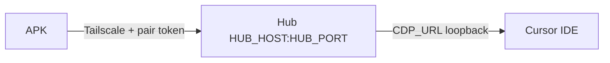

# Hub — `@cursor-mobile/hub`

Local HTTP/WS control plane for the PC-local Cursor companion (Phase 0–1).

**Product locks:** PC-local only · open-project remote · Tailscale + pairing · CDP `127.0.0.1` only · no cloud.

## Surface

| Method | Path | Auth | Notes |
|--------|------|------|-------|
| `GET` | `/v1/health` (also `/health`) | public | Hub up + CDP + `liveAdapter` triad |
| `POST` | `/v1/pair/start` | public (operator) | Issues short-lived code + QR payload |
| `POST` | `/v1/pair/confirm` or `/v1/pair/complete` | public (code) | Issues in-memory device token |
| `GET` | `/v1/workspace` | Bearer | Bound project or `NO_FOLDER_OPEN` |
| `GET` | `/v1/workspace/models` | Bearer | Env / default model catalog (**DESIGNED** stub) |
| `GET` | `/v1/workspace/files?q=` | Bearer | FS scan of `CURSOR_WORKSPACE` (**DESIGNED** stub) |
| `GET` | `/v1/workspace/file?path=` | Bearer | Optional Phase 3 text preview (64KB cap; roots only) |
| `GET` | `/v1/workspace/tools` | Bearer | Tools note from adapter health + optional env MCP |
| `GET` | `/v1/sessions?workspaceId=&mode=live` | Bearer | Live list (empty when `cursor_down`) |
| `GET` | `/v1/sessions/:id` | Bearer | Live session detail + Hub attachments |
| `POST` | `/v1/sessions` | Bearer + Idempotency-Key | Register live session via adapter |
| `POST` | `/v1/sessions/:id/messages` | Bearer + Idempotency-Key | Fail-closed if `extractor_stale` |
| `POST` | `/v1/sessions/:id/attachments` | Bearer + Idempotency-Key | Hub path registry; `domApplied: false` until DOM inject |
| `POST` | `/v1/sessions/:id/approvals` | Bearer + Idempotency-Key | Approve/Deny; fail-closed if stale |
| `WS` | `/v1/ws` (also `/ws`) | Bearer or `?access_token=` | hello / ping / health.changed |

Contract source: [`docs/reports/tor/TOR-03-hub-and-api-specification.md`](../../docs/reports/tor/TOR-03-hub-and-api-specification.md).

## Prerequisites

- Node.js ≥ 20
- From repo root: `npm install`
- Optional: Cursor launched with CDP on `http://127.0.0.1:9222`

## Configure

Copy [`.env.example`](../../.env.example) or export:

| Variable | Default | Meaning |
|----------|---------|---------|
| `HUB_HOST` | `127.0.0.1` | Bind address. For phone reachability use your **Tailscale IP** or hostname. Use `0.0.0.0` **only** when Tailscale ACLs protect the port — never expose Hub/CDP on a public interface. |
| `HUB_PORT` | `8787` | HTTP listen port |
| `CDP_URL` | `http://127.0.0.1:9222` | Loopback-only CDP endpoint |
| `CURSOR_WORKSPACE` | unset | Absolute path of the PC-open project (stub when CDP detect unavailable) |
| `CURSOR_MODELS` | built-in `composer`,`auto` | Comma list `id`, `id:label`, or `id:label:family`; `id*` marks default |
| `CURSOR_MCP_SERVERS` | unset | Optional tools stub `name[:toolCount][,…]` |
| `CURSOR_PLUGINS` | unset | Optional plugin name list |
| `LIVE_SELECTOR_PACK_READY` | `false` | Ops smoke override only; prefer per-action VERIFIED flags after manual Cursor UI check ([CONFIGURATION.md](../../docs/CONFIGURATION.md)) |
| `PAIRING_REQUIRED` | `true` | Require Bearer on protected routes |
| `TAILSCALE_HOSTNAME` | unset | Used in QR `baseUrlHint` |
| `HUB_DISPLAY_NAME` | `Desk PC` | Shown after pair |



## Run

### Packaged desktop

Download from the GitHub Release:

| OS | Artifact |
|----|----------|
| Linux | `cursor-mobile-hub-*-linux-x64.AppImage` |
| Windows | `cursor-mobile-hub-*-win-x64.exe` |
| macOS | `cursor-mobile-hub-*-darwin-arm64.zip` or `…-darwin-x64.zip` |

From source (same pipeline):

```bash
node scripts/package-desktop.mjs --platform linux   # or win / mac
# → dist-desktop/
```

### From source (CLI)

From repo root:

```bash
npm install
npm run build
npm run start
# Tailscale-friendly bind:
npm run start:hub:tailscale
```

Dev (tsx, no prior build):

```bash
cd packages/hub
npm run dev
```

## Tests

```bash
npm run test:hub
npm run test:phase1
```

## Not yet (gaps)

- Verified Composer DOM selector pack (mutations stay fail-closed)
- CDP scrape for models / MCP (still env / FS stubs — see response `note` fields)
- Composer DOM @-file inject (`POST …/attachments` registers Hub paths only; `domApplied: false`)
- History Index / open-on-pc (Phase 2)
- Persistent device-token store
