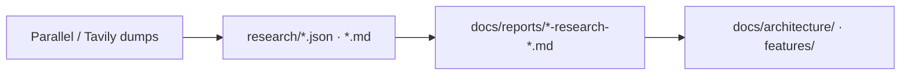

# Research index

Raw and Parallel research inputs for `cursor_mobile`. **Product decisions live in `docs/`**, not here.

> **Active scope:** PC-local only — no Cloud Agents / Remote Control as the product path. See [`../docs/architecture/AGENT-CONTEXT.md`](../docs/architecture/AGENT-CONTEXT.md).

---

## Current files

| File | Role |
|------|------|
| [cursor-mobile-remote-ide-oss.md](./cursor-mobile-remote-ide-oss.md) | Parallel deep-research notes (synthesized prose) |
| [cursor-mobile-remote-ide-oss.json](./cursor-mobile-remote-ide-oss.json) | Raw Parallel run metadata / excerpts |

---

## How research feeds reports

1. New external research lands under `research/` (keep JSON + a short `.md` summary).
2. Synthesize into a dated file under `docs/reports/` (e.g. `oss-landscape-research-2026-09-24.md`).
3. If the finding changes product truth, update `docs/architecture/` or `docs/features/` in the same turn — do not leave active scope only in research.
4. Mark superseded recommendations (especially cloud) explicitly; product locks in AGENT-CONTEXT win.

Canonical synthesized reports:

- [`../docs/reports/oss-landscape-research-2026-09-24.md`](../docs/reports/oss-landscape-research-2026-09-24.md)
- [`../docs/reports/tailscale-linking-research-2026-09-24.md`](../docs/reports/tailscale-linking-research-2026-09-24.md)
- [`../docs/reports/gap-closure-hybrid-system-2026-09-24.md`](../docs/reports/gap-closure-hybrid-system-2026-09-24.md)

---

## Agent note

Do not treat Cursor official Cloud Agents / Remote Control sections in these dumps as in-scope implementation targets. They are competitive/landscape context only.
